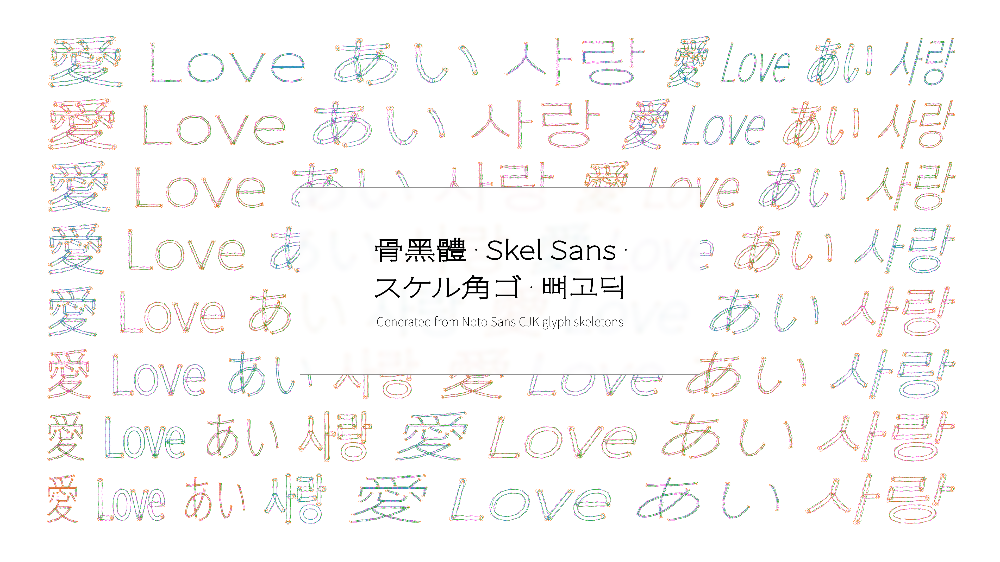
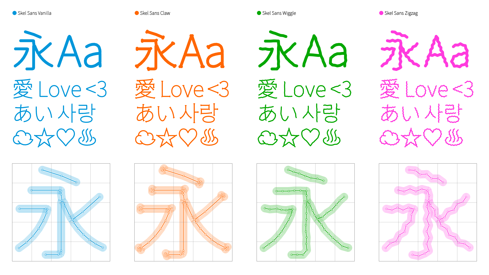
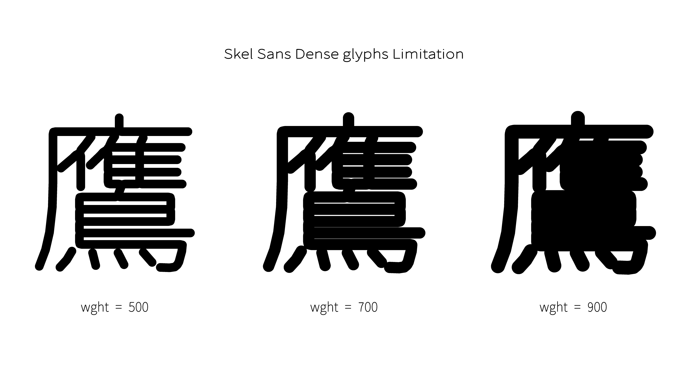

# Skel Sans

[English](README.md)

Skel Sans 是一套開源的生成式 CJK 可變字體，由 [Noto Sans CJK](https://github.com/notofonts/noto-cjk) 的中軸骨架衍生而成。Skel Sans 並非直接編輯原始字符輪廓，而是利用程式將字符重建為幾何線段，形成可連續調整字重、字寬與傾斜度的等線字體系統。

Designed and developed by [Yuhao Chang](https://yuh4o.tw/).

## 特色

- 四種造型風格：`Vanilla`、`Claw`、`Wiggle`、`Zigzag`
- 三個可變軸：字重（`wght`）、字寬（`wdth`）、傾斜（`slnt`）
- 收錄 65,535 個字形，其中超過 65,000 個由骨架生成
- 以幾何方法建構的等線字形
- 提供 OTF（CFF2）與 TTF（glyf/gvar）格式
- 採用 SIL Open Font License 1.1 授權

| 可變軸 | 標籤 | 範圍 | 預設值 |
| --- | --- | ---: | ---: |
| 字重 | `wght` | 100 至 900 | 100 |
| 字寬 | `wdth` | 62.5 至 150 | 100 |
| 傾斜 | `slnt` | -15 至 0 | 0 |

## 下載

> **目前版本：[Version 1.001](https://github.com/pacpapapa/skel-sans/releases/latest)** — 恢復 Version 1.000 遺漏的 OpenType 排版功能與 CJK 字體資料；字形輪廓未變更。完整變更請參閱 [FONTLOG.txt](FONTLOG.txt)。

字體檔以 [Releases 頁面](https://github.com/pacpapapa/skel-sans/releases)的 assets 形式發佈。完整的 OTF 與 TTF 檔案合計約 17.5 GB，因此不直接納入 Git 版本庫。GitHub 自動產生的 Source code 壓縮檔僅包含版本庫內容。下方連結會固定指向最新版本。

同一風格的 OTF 與 TTF 使用相同的系統字體名稱。為避免重複字體衝突，請勿同時安裝兩種格式。若不確定該選擇哪一種，建議優先使用 OTF，尤其是在 Adobe 軟體中使用時。

預覽字體效果可參考[字體樣本（PDF，2.2 MB）](https://github.com/pacpapapa/skel-sans/releases/latest/download/SkelSans-Specimen.pdf)。

### 完整版

完整版包含字重、字寬與傾斜三個可變軸。

| Vanilla | Claw | Wiggle | Zigzag |
| :---: | :---: | :---: | :---: |
| [OTF（489 MB）](https://github.com/pacpapapa/skel-sans/releases/latest/download/SkelSansVanilla-VariableFont_wght-wdth-slnt.otf) [TTF（446 MB）](https://github.com/pacpapapa/skel-sans/releases/latest/download/SkelSansVanilla-VariableFont_wght-wdth-slnt.ttf) | [OTF（850 MB）](https://github.com/pacpapapa/skel-sans/releases/latest/download/SkelSansClaw-VariableFont_wght-wdth-slnt.otf) [TTF（851 MB）](https://github.com/pacpapapa/skel-sans/releases/latest/download/SkelSansClaw-VariableFont_wght-wdth-slnt.ttf) | [OTF（610 MB）](https://github.com/pacpapapa/skel-sans/releases/latest/download/SkelSansWiggle-VariableFont_wght-wdth-slnt.otf) [TTF（568 MB）](https://github.com/pacpapapa/skel-sans/releases/latest/download/SkelSansWiggle-VariableFont_wght-wdth-slnt.ttf) | [OTF（872 MB）](https://github.com/pacpapapa/skel-sans/releases/latest/download/SkelSansZigzag-VariableFont_wght-wdth-slnt.otf) [TTF（817 MB）](https://github.com/pacpapapa/skel-sans/releases/latest/download/SkelSansZigzag-VariableFont_wght-wdth-slnt.ttf) |

### 輕量版

每種造型風格另提供六款僅保留一至兩個可變軸的輕量版；未保留的軸會固定在預設值。

| 後綴 | Vanilla | Claw | Wiggle | Zigzag |
| ---: | :---: | :---: | :---: | :---: |
| WD | [OTF（255 MB）](https://github.com/pacpapapa/skel-sans/releases/latest/download/SkelSansVanillaWD-VariableFont_wght-wdth.otf) [TTF（262 MB）](https://github.com/pacpapapa/skel-sans/releases/latest/download/SkelSansVanillaWD-VariableFont_wght-wdth.ttf) | [OTF（454 MB）](https://github.com/pacpapapa/skel-sans/releases/latest/download/SkelSansClawWD-VariableFont_wght-wdth.otf) [TTF（482 MB）](https://github.com/pacpapapa/skel-sans/releases/latest/download/SkelSansClawWD-VariableFont_wght-wdth.ttf) | [OTF（325 MB）](https://github.com/pacpapapa/skel-sans/releases/latest/download/SkelSansWiggleWD-VariableFont_wght-wdth.otf) [TTF（335 MB）](https://github.com/pacpapapa/skel-sans/releases/latest/download/SkelSansWiggleWD-VariableFont_wght-wdth.ttf) | [OTF（464 MB）](https://github.com/pacpapapa/skel-sans/releases/latest/download/SkelSansZigzagWD-VariableFont_wght-wdth.otf) [TTF（461 MB）](https://github.com/pacpapapa/skel-sans/releases/latest/download/SkelSansZigzagWD-VariableFont_wght-wdth.ttf) |
| WS | [OTF（188 MB）](https://github.com/pacpapapa/skel-sans/releases/latest/download/SkelSansVanillaWS-VariableFont_wght-slnt.otf) [TTF（180 MB）](https://github.com/pacpapapa/skel-sans/releases/latest/download/SkelSansVanillaWS-VariableFont_wght-slnt.ttf) | [OTF（332 MB）](https://github.com/pacpapapa/skel-sans/releases/latest/download/SkelSansClawWS-VariableFont_wght-slnt.otf) [TTF（319 MB）](https://github.com/pacpapapa/skel-sans/releases/latest/download/SkelSansClawWS-VariableFont_wght-slnt.ttf) | [OTF（232 MB）](https://github.com/pacpapapa/skel-sans/releases/latest/download/SkelSansWiggleWS-VariableFont_wght-slnt.otf) [TTF（217 MB）](https://github.com/pacpapapa/skel-sans/releases/latest/download/SkelSansWiggleWS-VariableFont_wght-slnt.ttf) | [OTF（329 MB）](https://github.com/pacpapapa/skel-sans/releases/latest/download/SkelSansZigzagWS-VariableFont_wght-slnt.otf) [TTF（300 MB）](https://github.com/pacpapapa/skel-sans/releases/latest/download/SkelSansZigzagWS-VariableFont_wght-slnt.ttf) |
| DS | [OTF（247 MB）](https://github.com/pacpapapa/skel-sans/releases/latest/download/SkelSansVanillaDS-VariableFont_wdth-slnt.otf) [TTF（237 MB）](https://github.com/pacpapapa/skel-sans/releases/latest/download/SkelSansVanillaDS-VariableFont_wdth-slnt.ttf) | [OTF（451 MB）](https://github.com/pacpapapa/skel-sans/releases/latest/download/SkelSansClawDS-VariableFont_wdth-slnt.otf) [TTF（423 MB）](https://github.com/pacpapapa/skel-sans/releases/latest/download/SkelSansClawDS-VariableFont_wdth-slnt.ttf) | [OTF（313 MB）](https://github.com/pacpapapa/skel-sans/releases/latest/download/SkelSansWiggleDS-VariableFont_wdth-slnt.otf) [TTF（294 MB）](https://github.com/pacpapapa/skel-sans/releases/latest/download/SkelSansWiggleDS-VariableFont_wdth-slnt.ttf) | [OTF（463 MB）](https://github.com/pacpapapa/skel-sans/releases/latest/download/SkelSansZigzagDS-VariableFont_wdth-slnt.otf) [TTF（425 MB）](https://github.com/pacpapapa/skel-sans/releases/latest/download/SkelSansZigzagDS-VariableFont_wdth-slnt.ttf) |
| W | [OTF（108 MB）](https://github.com/pacpapapa/skel-sans/releases/latest/download/SkelSansVanillaW-VariableFont_wght.otf) [TTF（101 MB）](https://github.com/pacpapapa/skel-sans/releases/latest/download/SkelSansVanillaW-VariableFont_wght.ttf) | [OTF（188 MB）](https://github.com/pacpapapa/skel-sans/releases/latest/download/SkelSansClawW-VariableFont_wght.otf) [TTF（173 MB）](https://github.com/pacpapapa/skel-sans/releases/latest/download/SkelSansClawW-VariableFont_wght.ttf) | [OTF（136 MB）](https://github.com/pacpapapa/skel-sans/releases/latest/download/SkelSansWiggleW-VariableFont_wght.otf) [TTF（121 MB）](https://github.com/pacpapapa/skel-sans/releases/latest/download/SkelSansWiggleW-VariableFont_wght.ttf) | [OTF（187 MB）](https://github.com/pacpapapa/skel-sans/releases/latest/download/SkelSansZigzagW-VariableFont_wght.otf) [TTF（164 MB）](https://github.com/pacpapapa/skel-sans/releases/latest/download/SkelSansZigzagW-VariableFont_wght.ttf) |
| D | [OTF（135 MB）](https://github.com/pacpapapa/skel-sans/releases/latest/download/SkelSansVanillaD-VariableFont_wdth.otf) [TTF（150 MB）](https://github.com/pacpapapa/skel-sans/releases/latest/download/SkelSansVanillaD-VariableFont_wdth.ttf) | [OTF（255 MB）](https://github.com/pacpapapa/skel-sans/releases/latest/download/SkelSansClawD-VariableFont_wdth.otf) [TTF（258 MB）](https://github.com/pacpapapa/skel-sans/releases/latest/download/SkelSansClawD-VariableFont_wdth.ttf) | [OTF（179 MB）](https://github.com/pacpapapa/skel-sans/releases/latest/download/SkelSansWiggleD-VariableFont_wdth.otf) [TTF（186 MB）](https://github.com/pacpapapa/skel-sans/releases/latest/download/SkelSansWiggleD-VariableFont_wdth.ttf) | [OTF（261 MB）](https://github.com/pacpapapa/skel-sans/releases/latest/download/SkelSansZigzagD-VariableFont_wdth.otf) [TTF（255 MB）](https://github.com/pacpapapa/skel-sans/releases/latest/download/SkelSansZigzagD-VariableFont_wdth.ttf) |
| S | [OTF（105 MB）](https://github.com/pacpapapa/skel-sans/releases/latest/download/SkelSansVanillaS-VariableFont_slnt.otf) [TTF（99 MB）](https://github.com/pacpapapa/skel-sans/releases/latest/download/SkelSansVanillaS-VariableFont_slnt.ttf) | [OTF（192 MB）](https://github.com/pacpapapa/skel-sans/releases/latest/download/SkelSansClawS-VariableFont_slnt.otf) [TTF（170 MB）](https://github.com/pacpapapa/skel-sans/releases/latest/download/SkelSansClawS-VariableFont_slnt.ttf) | [OTF（133 MB）](https://github.com/pacpapapa/skel-sans/releases/latest/download/SkelSansWiggleS-VariableFont_slnt.otf) [TTF（119 MB）](https://github.com/pacpapapa/skel-sans/releases/latest/download/SkelSansWiggleS-VariableFont_slnt.ttf) | [OTF（187 MB）](https://github.com/pacpapapa/skel-sans/releases/latest/download/SkelSansZigzagS-VariableFont_slnt.otf) [TTF（162 MB）](https://github.com/pacpapapa/skel-sans/releases/latest/download/SkelSansZigzagS-VariableFont_slnt.ttf) |

## 已知限制

- **高字重下的筆畫重疊：** 筆畫繁複的字符，尤其是複雜的 CJK 表意文字，可能隨 `wght` 增加而出現筆畫大幅重疊或字腔閉合，降低最重字重時的辨識度。

  

- **保留來源輪廓的字形：** 部分反白或封閉符號（如 `❶`、`🅐`、`🆋`）、製表符號（如 `┌`、`┍`、`┡`、`┟`），以及實心幾何符號（如 `■`、`●`、`♠`）無法產生適合的骨架。這些字符會保留 Noto Sans CJK 的原始輪廓，而不採用 Skel Sans 的筆畫建構方式。

- **TTF 在 Adobe 軟體中的表現：** TTF 版本在 Adobe Creative Cloud 軟體中的渲染速度可能較慢；部分字形在特定可變參數下也可能產生最多約 0.002 em 的垂直位移。這項應用程式特有的細微位移不會出現在 OTF 版本中。

- **檔案容量較大：** Skel Sans 保留 Noto Sans CJK 完整的 65,535 字字集，同時每個字符的輪廓點數平均約為來源字體的 3.5-6.1 倍；可變字體還需儲存多個母版的差異資料。若不需要全部三個可變軸，可選用輕量版以節省空間。

## 致謝

Skel Sans 的完成仰賴以下開源字體、函式庫與工具：

- [Noto Sans CJK](https://github.com/notofonts/noto-cjk)：提供來源字形與字元集
- [flo-mat](https://github.com/FlorisSteenkamp/mat)：骨架擷取所使用的中軸轉換實作
- [Paper.js](https://github.com/paperjs/paper.js)：用於向量幾何處理
- [opentype.js](https://github.com/opentypejs/opentype.js)：用於讀取與解析 OpenType 字體資料
- [fontTools](https://github.com/fonttools/fonttools)：用於組裝、子集化與驗證最終的可變字體
- Google Antigravity、Claude Code 與 OpenAI Codex：協助程式實作、測試與除錯

## 授權

Skel Sans 字體檔案採用 [SIL Open Font License 1.1](https://openfontlicense.org/) 授權。`Skel` 為保留字體名稱（Reserved Font Name）。
